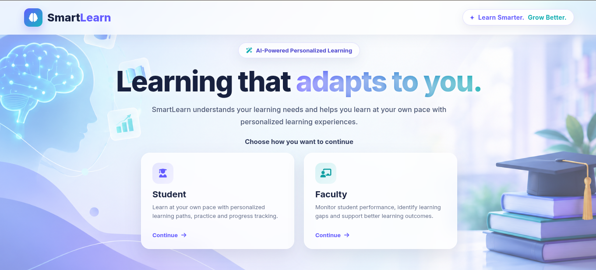

# SmartLearn – AI-Powered Personalized Learning Platform

**Learn Smarter. Grow Better.**

## 📌 Project Overview

SmartLearn is an AI-powered personalized learning platform designed to improve students' learning experiences through personalized learning paths, assessments, practice activities, and progress tracking.

The platform helps students identify their strengths and weaknesses, practice different topics, understand their learning performance, and improve continuously.

It provides separate dashboards and functionalities for students and faculty.

## 🎯 Objectives

- Identify students' strengths and weak areas through assessments.
- Provide personalized learning recommendations.
- Enable students to practice topics and improve their understanding.
- Analyze student performance.
- Track learning progress over time.
- Help faculty monitor student performance.

## ✨ Key Features

### 👨‍🎓 Student Module
- Student registration and login.
- Student dashboard.
- Diagnostic assessments.
- Personalized learning.
- Topic-wise practice activities.
- AI Analysis of learning performance.
- Progress tracking.

### 👩‍🏫 Faculty Module
- Faculty registration and login.
- Faculty dashboard.
- Student information and performance overview.
- Student progress and weak-area monitoring.

## 🔄 Working Flow

1. **Assess:** Students take diagnostic assessments.
2. **Analyze:** Performance is analyzed to identify strengths and weaknesses.
3. **Personalize:** Learning content and recommendations are organized according to student needs.
4. **Practice:** Students practice topics to improve their understanding.
5. **Improve:** Students monitor their progress and work on weaker areas.

## 🛠️ Technologies Used

- HTML5
- CSS3
- JavaScript
- Bootstrap
- Browser Local Storage

## 📂 Project Modules

- Login and Registration
- Student Dashboard
- Faculty Dashboard
- Assessment
- Learn
- Practice
- AI Analysis
- Personalized Learning
- Progress Tracking

## 🚀 How to Run the Project

1. Clone this repository:

   
   git clone https://github.com/gopavarapuvyshnavi66-tech/smartLearn
   

2. Open the downloaded project folder.
3. Open `index.html` in your browser.
4. Register or log in to explore the platform.

Alternatively, open the project folder in VS Code and use the Live Server extension.

## 📸 Application Preview

### SmartLearn – Main Login Page

The main login page provides separate access for students and faculty.

## 🔮 Future Enhancements

- Integration with real AI/ML models for intelligent recommendations.
- Backend database integration.
- Secure authentication and role-based access control.
- Dynamic learning resource recommendations.
- Advanced faculty analytics and reporting.

## 👩‍💻 Project Information

**Project Name:** SmartLearn – AI-Powered Personalized Learning Platform

**Domain:** Artificial Intelligence in Education

**Project Type:** Web Application

---

*Developed as a student innovation project focused on personalized and adaptive learning.*
